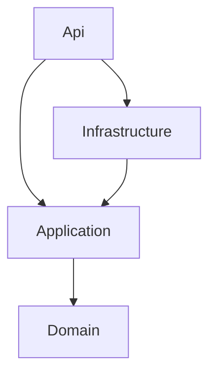

# ADR-0001: Four-Project Clean Architecture

- **Status:** accepted
- **Date:** 2026-11-11
- **Decision owner:** architect
- **Related requirements:** R-01, R-02, R-11, R-12, R-25

## Context

The exercise explicitly asks for Clean Architecture principles: separation of concerns and component independence. The application is small (users, tasks, auth, CRUD), but the panel will review the code and ask why the boundaries exist. The deadline is Friday 2026-11-13, so the design must be visible without becoming ceremony.

The brief mentions "ASP.NET MVC, Web API" and also requires a frontend framework. The chosen reading is: the API uses the MVC pattern through controllers, and the React SPA is the view layer. Razor views would duplicate the frontend requirement and consume time.

## Decision

Use four backend projects with a strict dependency rule:



- **`CrudWorks.Domain`** — entities, enums, invariants, domain exceptions. No project references.
- **`CrudWorks.Application`** — use cases, validators, DTOs, repository interfaces, auth abstractions. References only `Domain`.
- **`CrudWorks.Infrastructure`** — EF Core `DbContext`, configurations, repositories, migrations, seed, password hasher, JWT token service. References `Application`.
- **`CrudWorks.Api`** — controllers, authentication/authorization wiring, ProblemDetails, OpenAPI, health, CORS, DI. References `Application` and `Infrastructure`.

Additional rules:

- Repository interfaces live in `Application`; implementations live in `Infrastructure`.
- No generic repository. One interface per aggregate: `IUserRepository`, `ITaskRepository`.
- Controllers are thin; business decisions live in `Application`.
- No MediatR, CQRS, AutoMapper, or message broker.
- Manual mapping with small extension methods.
- `IUnitOfWork` exposes `SaveChangesAsync`; repositories do not call it implicitly.

### Folder map

This map describes the **delivered** code (verified against `project/src/` on
2026-11-12), not an intended target.

```text
project/
├── CrudWorks.slnx
├── Directory.Build.props
├── global.json
├── src/
│   ├── CrudWorks.Domain/
│   │   ├── Users/User.cs
│   │   ├── Tasks/TaskItem.cs
│   │   ├── Tasks/TaskItemStatus.cs
│   │   └── Common/DomainException.cs
│   ├── CrudWorks.Application/
│   │   ├── Auth/            (AuthService, IAuthService, AuthMapping, AuthValidation,
│   │   │                    IPasswordHasher, ITokenService, ILoginAudit, JwtOptions,
│   │   │                    AuthClaimNames, DTOs)
│   │   ├── Common/          (ICurrentUser.cs, Exceptions/)
│   │   ├── Tasks/           (TaskService, ITaskService, ITaskRepository, TaskMapping,
│   │   │                    TaskValidation, DTOs)
│   │   └── Users/           (IUserRepository.cs, IUnitOfWork.cs)
│   ├── CrudWorks.Infrastructure/
│   │   ├── Persistence/     (CrudWorksDbContext, TaskRepository, UserRepository,
│   │   │                    UnitOfWork, Configurations/, Migrations/,
│   │   │                    Seed/DatabaseSeeder.cs, DesignTimeDbContextFactory.cs)
│   │   └── Security/        (PasswordHasherAdapter.cs, JwtTokenService.cs)
│   └── CrudWorks.Api/
│       ├── Authentication/  (AuthenticationSetup.cs)
│       ├── Controllers/     (AuthController.cs, TasksController.cs)
│       ├── ErrorHandling/   (ApiProblemDetails.cs, ProblemDetailsExceptionHandler.cs)
│       ├── Security/        (HttpCurrentUser.cs, JwtSigningKey.cs, LoginAudit.cs)
│       └── Program.cs
├── tests/
│   ├── CrudWorks.Domain.Tests/
│   ├── CrudWorks.Application.Tests/
│   ├── CrudWorks.Infrastructure.Tests/
│   └── CrudWorks.Api.Tests/
└── frontend/                (React SPA — see ADR-0005)
```

Notes on the map:

- Ports are grouped **by feature**, not in a separate `Abstractions/` folder:
  `IUserRepository` and `IUnitOfWork` sit in `Application/Users/`,
  `ITaskRepository` in `Application/Tasks/`, and `ICurrentUser` in
  `Application/Common/`.
- The API has **no `Contracts/` folder**. Request and response DTOs live with
  their use case in `CrudWorks.Application` (`Auth/`, `Tasks/`), and the
  controllers return those DTOs directly — there is no second, API-level
  contract type to keep in sync.
- There is **no `HealthController`**. `GET /api/health` is an ASP.NET Core
  health check mapped in the composition root: `app.MapHealthChecks("/api/health", ...)`
  in `project/src/CrudWorks.Api/Program.cs:103`. It has no MVC action, no
  controller, and no route attributes; it is anonymous by construction.
- The Infrastructure implementations of the Application ports sit **beside**
  their context (`Persistence/TaskRepository.cs`, `Persistence/UserRepository.cs`,
  `Persistence/UnitOfWork.cs`) and the security implementations live in
  `Infrastructure/Security/` (`PasswordHasherAdapter.cs` adapts
  `PasswordHasher<User>`; `JwtTokenService.cs` issues the token). The port
  `ILoginAudit` is implemented in `Api/Security/LoginAudit.cs` because it writes
  to `ILogger` and is an API-host concern, not a persistence concern.
- `ProjectReference`s enforce the rule and are the proof of the diagram:
  `Domain` → none; `Application` → `Domain`; `Infrastructure` → `Application`;
  `Api` → `Application` + `Infrastructure`.

## Alternatives considered

| Option | Pros | Cons | Why not chosen |
| --- | --- | --- | --- |
| Single project with folders | Fastest to scaffold; fewer files | The dependency rule is invisible; the panel has to trust the folders | The brief explicitly evaluates Clean Architecture |
| Vertical slices | Modern, feature-focused, low ceremony | Harder to show component independence and layer boundaries in a small code review | The exercise asks for layers, not a different architecture style |
| MediatR/CQRS | Demonstrates patterns; common in enterprise .NET | Extra indirection for two aggregates; more to explain, not more behavior | Overengineering for a two-day exercise |
| Microservices | Shows distributed thinking | Not asked; adds deployment, contracts, and failure modes | Scope creep; the brief asks for one application |

## Consequences

### Positive

- The dependency rule is enforceable by project references, not by convention.
- Domain and Application are testable without a database or HTTP.
- The panel can see the architecture in the solution explorer in seconds.
- Repository interfaces make the data layer replaceable for tests.

### Negative / trade-offs

- More projects and files than a single-project CRUD app.
- Mapping from domain entities to response DTOs adds code; it is manual and
  small, and it lives in `Application` (`TaskMapping`, `AuthMapping`) because the
  API reuses the Application DTOs instead of defining a second contract type.
- The four-project structure can look like ceremony if the code is thin; the ADR and the README must explain the "why".

## Validation

- Project references match the diagram; no forbidden reference exists.
- Domain and Application tests run without EF Core or ASP.NET Core.
- The reviewer checks the dependency rule on every change.
- `docs/02-definition-of-done.md` §1 is fully checked.

## Build order

1. Solution + four projects + references + `Directory.Build.props`.
2. Domain entities + domain tests.
3. Application interfaces, services, validators + unit tests.
4. Infrastructure EF Core, repositories, migrations, seed.
5. API controllers, auth, ProblemDetails, OpenAPI, health.
6. API tests and final review.

## Links

- `docs/00-brief.md` — R-01, R-02, R-11, R-12, R-25.
- `docs/03-stack-baseline.md` — backend stack.
- `docs/02-definition-of-done.md` — architecture checklist.

## Change log

| Date | Change | Why |
| --- | --- | --- |
| 2026-11-12 | Rewrote the folder map to match the delivered code: removed the `Abstractions/` and API `Contracts/` folders, moved the repository implementations out of `Persistence/Repositories/`, renamed `Infrastructure/Auth/` to `Infrastructure/Security/`, removed the non-existent `HealthController`, replaced `CrudWorks.sln` with `CrudWorks.slnx`, and added the `frontend/` folder and the missing `Api/` folders. Corrected the trade-off bullet about API contracts to match the code (DTOs live in `Application`). | The final review (`docs/reviews/final-review.md`) flagged the map as stale. A reviewer reads the map as a description of the delivered code, so it must match the tree. The **decision** is unchanged: four projects, same dependency rule, same boundaries. |
